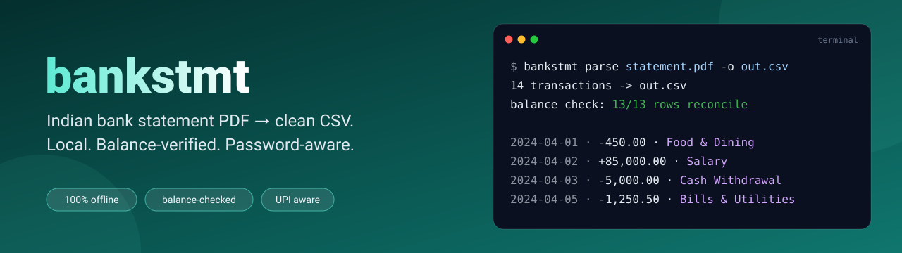
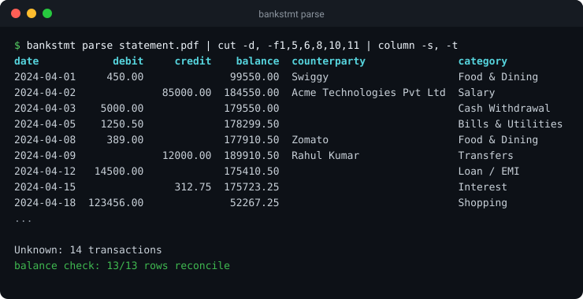
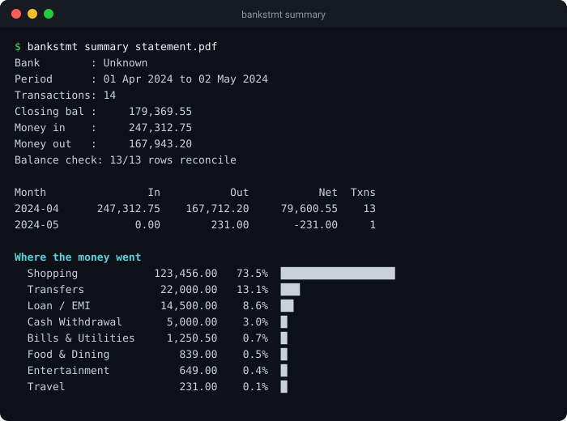
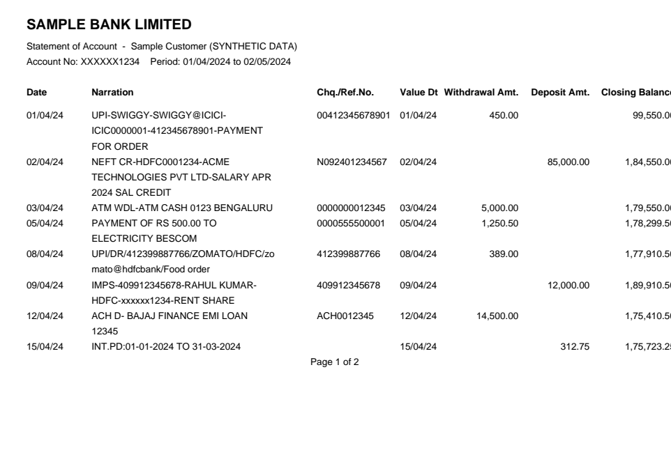
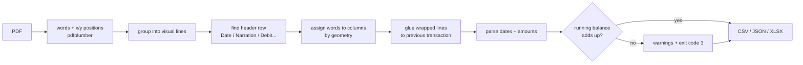

<p align="center">
  
</p>

<p align="center">
  <a href="https://github.com/Gana-Y/bankstmt/actions/workflows/ci.yml"></a>
  
  
  
  
</p>

<h3 align="center">Your bank statement is a PDF. Your budget needs a spreadsheet.</h3>

**bankstmt** turns Indian bank-statement PDFs into clean **CSV / JSON / Excel**, entirely on your machine. Nothing is uploaded anywhere. Unlike most converters it **checks the running balance row by row**, so you *know* when a transaction was misread or missed instead of silently getting wrong numbers.

<p align="center">
  
</p>

> The images in this README are generated from real runs on the **synthetic** sample statements in [`examples/`](examples). See [Status & honesty](#status--honesty).

## Why

Every personal-finance tool wants you to upload your bank statement to someone's server. Most PDF-to-Excel converters also guess: tables without ruled lines break, wrapped narrations become separate rows, `1,23,456.00` turns into text, and you only find out when your totals don't match.

bankstmt is built around three ideas:

1. **Local only.** No network code at all. Safe for sensitive data.
2. **Verify, don't hope.** Every row is checked against `previous balance ± amount = balance`. Mismatches are reported and the CLI exits non-zero.
3. **Understand Indian formats.** UPI / NEFT / IMPS / RTGS / ATM / ACH narrations, lakh-crore number grouping, `dd/mm/yy` and `dd Mon yyyy` dates, `Cr`/`Dr` suffixes, password-protected PDFs.

## Features

| | |
|---|---|
| **Layout-aware** | Finds the header row (Date / Narration / Debit / Credit / Balance ...) and assigns words to columns by position, so it works even when the PDF draws **no table lines** |
| **Wrapped narrations** | Multi-line descriptions are merged into the transaction above |
| **Balance verification** | Row-by-row reconciliation with warnings; detects **newest-first** statements and reorders them |
| **Debit/credit handling** | Separate columns, a single *Amount* column with `Dr/Cr`, `Cr`/`Dr` suffixes, negative or `(bracketed)` numbers |
| **UPI & transfer aware** | Extracts transaction type, counterparty and 12-digit reference from UPI/NEFT/IMPS narrations |
| **Auto-categories** | Rule-based (food, travel, bills, salary, EMI ...). Bring your own rules via JSON |
| **Password-protected PDFs** | `--password`, `--ask-password` or `BANKSTMT_PASSWORD` |
| **Merge many files** | Pass 12 monthly PDFs, get one de-duplicated chronological CSV |
| **Outputs** | CSV, JSON, Excel (`.xlsx` with formatted headers, number formats, filters) |
| **Summary** | Monthly in/out/net and a spending-by-category breakdown |

## Install

```bash
pip install bankstmt              # core (CSV / JSON)
pip install "bankstmt[xlsx]"      # + Excel export
# or the latest from GitHub:
pip install "git+https://github.com/Gana-Y/bankstmt.git"
```

Python 3.9+. The only required dependency is [`pdfplumber`](https://github.com/jsvine/pdfplumber).

## Usage

```bash
bankstmt parse statement.pdf -o out.csv          # CSV
bankstmt parse statement.pdf -o out.xlsx         # Excel
bankstmt parse statement.pdf -o out.json         # JSON with totals + warnings
bankstmt parse jan.pdf feb.pdf mar.pdf -o q1.csv # merge, sort, de-duplicate

bankstmt parse locked.pdf --ask-password -o out.csv   # prompt (keeps it out of shell history)
bankstmt parse statement.pdf --rules my_rules.json    # your own categories
bankstmt parse statement.pdf --date-format "%d/%m/%Y"

bankstmt summary statement.pdf                   # cash-flow + spending by category
bankstmt inspect statement.pdf                   # show how the table header was understood
```

**Exit codes:** `0` fine, `1` error (wrong password, no table found ...), `3` parsed but the **balance check found mismatches**, handy in scripts.

<p align="center">
  
</p>

### What it reads

<p align="center">
  
</p>

No ruled lines, a wrapped narration, a separate value-date column: this is the kind of page that defeats naive table extractors. Try it yourself with the sample PDFs in [`examples/`](examples).

### Output columns

`date, value_date, description, ref_no, debit, credit, amount, balance, type, counterparty, category, bank`

* `amount` is **signed**: credits positive, debits negative.
* Dates are ISO (`YYYY-MM-DD`) unless you pass `--date-format`.
* `type` is one of `UPI, IMPS, NEFT, RTGS, ATM, POS, ACH, CHEQUE, INTEREST, CHARGES, OTHER`.

### Python API

```python
from bankstmt import parse_pdf, format_summary

stmt = parse_pdf("statement.pdf", password="secret")   # password optional

print(stmt.bank, stmt.period, stmt.closing_balance)
print(stmt.mismatched_rows, "rows failed the balance check")

for tx in stmt.transactions:
    print(tx.date, tx.amount, tx.counterparty, tx.category)

print(format_summary(stmt))
```

Custom categories (`my_rules.json`); yours are checked before the built-ins:

```json
{ "Pets": ["happy tails", "pet store"], "Gym": ["cult.fit", "anytime fitness"] }
```

## How it works



Bank detection only fills the `bank` column. Parsing is **header-driven rather than per-bank templates**, which is why a new layout usually works without code changes, and also why the honesty section below matters.

## Status & honesty

Please read this before trusting it with real data:

- bankstmt has been developed and tested against **synthetic statements** that imitate common Indian layouts (borderless tables, wrapped narrations, split dates, centred headers, a single Amount + Dr/Cr column, newest-first order, password protection). Real statements are the point of the project, but I cannot publish tests built from anybody's real data.
- **It has not been validated against every bank.** The bank-name detection list is only a label. If a layout fails, that is a bug I want to know about: see [CONTRIBUTING.md](CONTRIBUTING.md). `bankstmt inspect` prints only column names and positions, so it is safe to paste into an issue.
- That is exactly why the **balance check** exists. If it reports `N/N rows reconcile`, the amounts and directions are almost certainly right; if not, you get a warning with the date and row.
- Categories and counterparty extraction are **heuristics**. Treat them as a head start, not accounting truth.

**Not supported (yet):** scanned/image PDFs (no OCR), credit-card statements, amounts printed without decimals in the money columns, and statements with several accounts in one table.

> Never post a real statement in an issue. Redact it or reproduce the layout with `tests/samples.py`.

## Privacy

There is no network code in this package. No telemetry and no cloud calls. Run it offline if you like.

## Roadmap

- [ ] OCR fallback for scanned statements
- [ ] Credit-card statement layouts
- [ ] `--redact` to anonymise descriptions before sharing
- [ ] More categories / merchant rules, community-maintained
- [ ] Summary sheet in the Excel export
- [ ] More layout fixtures contributed by users

## Development

```bash
git clone https://github.com/Gana-Y/bankstmt.git && cd bankstmt
pip install -e ".[dev]"
pytest                          # 90+ tests; PDFs are generated on the fly by tests/samples.py
python tests/samples.py examples   # regenerate the demo PDFs
```

## ⭐ Explore My Other Repositories

| Repository | Description | Domain |
| :--- | :--- | :--- |
| 🧪 [**promptunit**](https://github.com/Gana-Y/promptunit) | Pytest-native unit tests for LLM prompts, chains & agents with replay caching & fluent assertions. | `AI Evals / Prompt Testing` |
| 🪔 [**indickit**](https://github.com/Gana-Y/indickit) | Zero-dependency Indian NLP toolkit & rule-based LLM benchmark for 10 Indian languages. | `NLP / Indic LLM Evals` |
| 🚀 [**Florix_AI**](https://github.com/Gana-Y/Florix_AI) | Production-grade multimodal AI study platform with in-database RAG and adaptive spaced repetition. | `Full-Stack RAG / AI` |
| ⚡ [**vesper-engine**](https://github.com/Gana-Y/vesper-engine) | High-performance sandboxed code execution engine & 7-state POSIX arbiter with Linux cgroups v2. | `Systems / Sandbox` |
| 📈 [**OrderCore**](https://github.com/Gana-Y/OrderCore) | High-throughput Limit Order Book & matching engine in Python (FastAPI/WebSockets) achieving 136k orders/sec. | `Low-Latency Systems / FinTech` |
| 🔌 [**Supercharged-MCP**](https://github.com/Gana-Y/Supercharged-MCP) | Model Context Protocol handbook: 25+ production servers, Python FastMCP & TS SDK starters, Docker sandbox. | `Anthropic MCP Production Kit` |

## 👨‍💻 Author & Maintainer

Maintained with ❤️ by **[Ganesh Yandigeri](https://github.com/Gana-Y)**

- 🌐 **Portfolio:** [ganesh-portfolio-silk-five.vercel.app](https://ganesh-portfolio-silk-five.vercel.app)
- 💼 **LinkedIn:** [linkedin.com/in/ganesh-yandigeri](https://linkedin.com/in/ganesh-yandigeri)
- 🐙 **GitHub:** [@Gana-Y](https://github.com/Gana-Y)

## License

[MIT](LICENSE) © 2026 Ganesh Yandigeri

---

<p align="center"><sub>If bankstmt saved you an evening of copy-pasting from a PDF, a ⭐ helps others find it.</sub></p>
